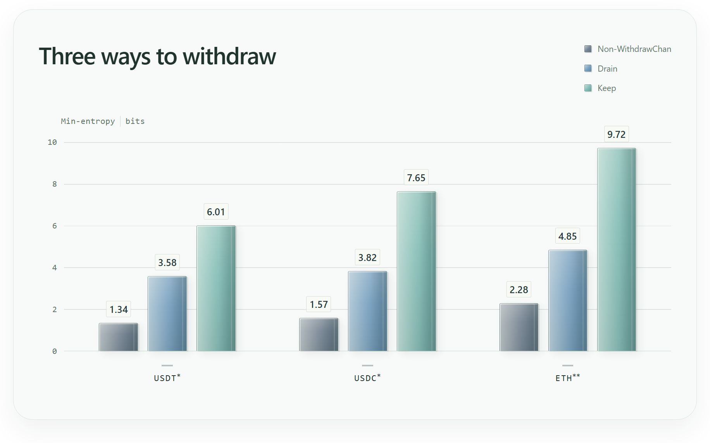

# WithdrawChan

[English](README.md) | [简体中文](doc/README.zh.md)

As we know, Ethereum is a blockchain with publicly visible accounts. To address users' privacy concerns, protocols such as Tornado Cash, [Privacy Pools](https://privacypools.com/), and [Railgun](https://railgun.org/) use zero-knowledge proofs to let users withdraw funds to another address without directly revealing the link between a deposit and a withdrawal. Appealing though these cryptographic solutions may be, less-than-clever withdrawal habits can leave outside observers with rather a lot to analyze, including but not limited to:
- Withdrawing the same amount within a short time window
- Withdrawing an amount whose significant digits exactly match those of the deposit
- Withdrawing an amount that only a handful of depositors could afford
- And so on...

We are delighted to introduce WithdrawChan, a dWeb site that helps you develop good withdrawal hygiene by recommending withdrawal amounts. Simply enter how much you need right now (and, optionally, the maximum you are willing to withdraw), and after 21 days[^1], you too can do a rather better job of protecting your financial privacy!

👉 [WithdrawChan](https://withdrawchan.gwei.limo)

### Where the Privacy Comes From

According to Ben's research[^2], withdrawing everything and withdrawing in a hurry are major sources of privacy leakage. Hasty withdrawals, in particular, can narrow the candidate set to roughly nine newly approved deposits. That means an observer—or, if you prefer, an analyst or an attacker—needs only seven or eight guesses to find your address for certain! WithdrawChan therefore considers withdrawing in batches a good idea.

But how much should you withdraw each time? The very fact that you are asking yourself that question makes you an important source of randomness! The reasons you need the money introduce far more variety than our coin tosses ever could.

And if you are willing to leave just a little money in the pool—for example, around 10 USDT in the mainnet PPv1 USDT pool—you can protect yourself even better!

### So WithdrawChan Doesn't Actually Do Anything?

Quite right. WithdrawChan cannot know your balance, nor does it want to. All it does is round the amount you provide, then toss a coin to decide whether to round it up to an even neater number: heads, we carry on; tails, we hand you the number. Naturally, it cannot exceed your chosen maximum. For example:

Say you need 43.21 USDT and are willing to withdraw up to 120 USDT. We round 43.21 up to 44, then toss a coin:

| Current amount | Tails | Heads |
|---|---|---|
| 44 USDT | Suggest 44 and stop | Move up to 50 and toss again |
| 50 USDT | Suggest 50 and stop | Move up to 100 and stop |
We stop tossing at 100, as going any higher would exceed your chosen maximum of 120 USDT.

There are a few benefits and tips worth mentioning:
- Rounding removes some trailing digits, reducing the clues available for matching withdrawals directly by their endings.
- We cannot force you not to withdraw your entire balance at once, but the input field can certainly "insist". 😈
- Do not enter your balance as the maximum. That is exactly where an observer will be waiting for you. (For any single transaction, one can establish only that the withdrawal amount <= the deposit amount and that the withdrawal time > the deposit time.)
- Even if you do enter your balance as the maximum (which we strongly advise against), a fair coin can still reduce your exposure when the observer knows the algorithm.

### It Really Does Work!

Using Privacy Pools v1, we simulated three withdrawal strategies: not using WithdrawChan, using it but eventually withdrawing everything, and using it while leaving a little behind. We then asked up to four types of observers to guess which deposit had funded each withdrawal.

> We measure privacy using min-entropy[^3] [^4]. Roughly speaking, every increase of 1 makes a correct guess twice as difficult.
>
> To put that into perspective, a min-entropy of 3 gives an observer a one-in-eight chance of guessing correctly; at 10, it is one in 1,024. That should keep them occupied for a while.

\* Strongest of four observers. \*\* Strongest of three public observers. Adoption rate 50%, default maximum.

Under the conditions tested in our simulations, WithdrawChan can help you blend into a crowd of around 1,000 people.

For the experimental details, see `lab/`. If you are so inclined, you can easily reproduce our experiments by importing Privacy Pools' on-chain data. Or you could have your bot do it while you enjoy a coffee. ☕

### Privacy Notice

WithdrawChan's calculations all take place locally in your browser, and your inputs are not shared with RPC endpoints or any other party. You should nevertheless take care with the security of your device and your network provider. The [WithdrawChan site](https://withdrawchan.gwei.limo) is distributed via IPFS + [GNS](https://gwei.domains/); if you want to protect your privacy as far as possible, we recommend [running your own instance](web/README.md).

### Acknowledgments

[^1]: Just a joke: the claim that it takes "21 days to form a habit" is a misreading of Maxwell Maltz. We borrow the popular saying here simply to suggest that WithdrawChan can help you develop good withdrawal hygiene.

[^2]: [How Private Is Privacy Pools? | Ben](https://ethprivacy.tools/how-private-is-privacy-pools/)

[^3]: Braun C, Chatzikokolakis K, Palamidessi C. Quantitative Notions of Leakage for One-try Attacks. _Electronic Notes in Theoretical Computer Science_ Proceedings of the 25th Conference on Mathematical Foundations of Programming Semantics (MFPS 2009), 2009;**249**:75–91. [https://doi.org/10.1016/j.entcs.2009.07.085](https://doi.org/10.1016/j.entcs.2009.07.085).

[^4]: Alvim MS, Chatzikokolakis K, Palamidessi C _et al._ Measuring Information Leakage Using Generalized Gain Functions. _2012 IEEE 25th Computer Security Foundations Symposium_ June 2012:265–79. [https://doi.org/10.1109/CSF.2012.26](https://doi.org/10.1109/CSF.2012.26).
