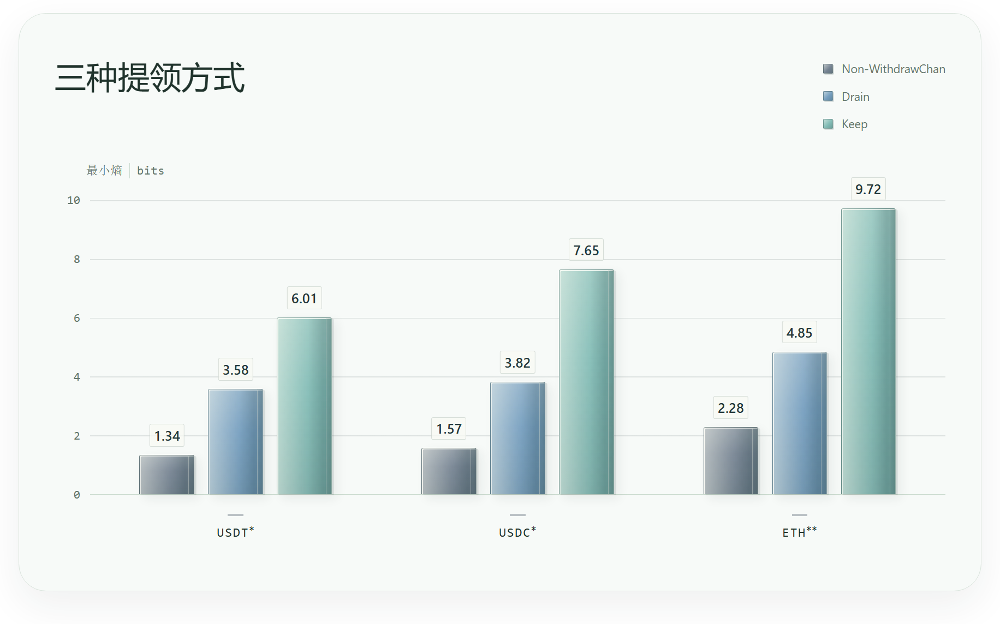

# WithdrawChan

[English](../README.md) | [简体中文](README.zh.md)

我们知道以太坊是一个公开账户的区块链，为了解决用户隐私的问题，TornadoCash、[Privacy Pools](https://privacypools.com/)、[Railgun](https://railgun.org/) 等隐私协议，利用零知识证明的方式使得用户可以在不直接公开存款与提款关联的情况下，将资金提领至另一个地址。虽然在密码学层面这些协议的解决方案相当有吸引力，但不聪明的提领方式常常能够给外部观察者可供分析的空间，包括但不限于：
- 短时间窗口内的同额提领
- 提领金额的若干有效数字与存入金额完全一致
- 在只有少数人才付得起的金额区间上提领
- ……

我们很高兴向您介绍 WithdrawChan，这是一个帮助你养成良好的提领习惯（Withdrawal Hygiene）的 dWeb Site，通过提领金额的推荐，仅需输入当前所需的金额（以及可选的最大金额），经过 21 天以后[^1]，你就能把自己的金融隐私保护得更好！

👉 [WithdrawChan](https://withdrawchan.gwei.limo)

### 隐私性的来源

根据 Ben 的研究[^2]，全额提领以及匆忙提领是隐私泄露的重要原因，其中匆忙提领更是让候选范围缩小到约 9 笔新批准的存款，这意味着观察者——或者叫做分析者或者攻击者——只需要猜 7~8 次就一定能够找到你的地址！因此，WithdrawChan 认为分批提领是一个好主意。

那么每一批应该提多少呢？在思考这个的你本身就是随机性的重要来源了！要用钱的理由所带来的随机性，可比我们抛硬币丰富多了。

假设你还愿意留一点点钱在池里不提出来——比如对于主网的 PPv1 USDT 池，留下 ~10 USDT——那你可以将自己保护得更好！

### 看起来 WithdrawChan 什么都没做？

你这么想实在太对了，WithdrawChan 不能知道你的余额，更不想知道，所做的只是先把你提供的金额取整，再抛硬币，看看要不要往上凑个更整的数：正面就继续，反面就把数丢给你。当然，不能超过最大金额。举个例子：

假设你现在需要 43.21 USDT，最多愿意提 120 USDT。先把 43.21 向上取整到 44，再抛硬币：

| 当前金额    | 抛到反面     | 抛到正面      |
| ------- | -------- | --------- |
| 44 USDT | 推荐 44，停下 | 进到 50，再抛  |
| 50 USDT | 推荐 50，停下 | 进到 100，停下 |
到了 100 就不再抛了，再往上会超过你设定的 120 USDT 上限。

这里有一些好处和贴士：
- 取整去掉了部分零头，减少了一些直接按零头匹配的线索
- 我们不能强制要求你不一次提光，但可以通过输入框“要求”你😈 
- 不把余额填进最大值，观察者会在这里等着你（在单笔交易内，只能证明提领金额 <= 存入金额，提领时间 > 存入时间）
- 即使你将余额填入最大值（我们很不建议你这么做），在观察者知道算法的情况下，公平硬币也能减轻你的暴露风险

### 效果真的很好！

我们基于 Privacy Pools v1，模拟了不使用 WithdrawChan、使用但最终提光、使用并留一点三种提领方式，再请最多四种观察者来猜：每笔提领的钱，到底来自哪笔存款？

> 我们通过最小熵[^3][^4]衡量隐私性，可以认为每增大 1，就比之前更难猜一倍。
> 
> 打个比方，最小熵等于 3，猜中的机会就像 8 选 1；如果等于 10，那就是 1024 选 1——够观察者头疼一阵子了。

\* 四个观察者中最强的结果。\*\* 三个公开观察者中最强的结果。采用率 50%，默认上限。

在可见的模拟情况下，使用 WithdrawChan 能帮你混入 ~1000 个人的人群当中。

具体实验细节请见 `lab/`，只要你愿意，导入 Privacy Pools 的链上数据可以很容易地复现我们的实验，你也可以让你的 Bot 去完成，而你负责喝咖啡☕

### 隐私提示

WithdrawChan 所有计算都在你本地浏览器内进行，不会与 RPC 或其他实体交换你的输入，但你仍需注意本地设备的安全与网络提供方。此外，[WithdrawChan 网页](https://withdrawchan.gwei.limo)基于 IPFS + [GNS](https://gwei.domains/) 分发，如果你希望尽可能保证隐私，我们推荐你[运行一个属于你自己的实例](web.README.zh.md)。

### Acknowledgments

[^1]: 仅调侃：“21 天养成习惯”是对 Maxwell Maltz 说法的误读，本文借用这个社会流行语是想说，我们推荐通过 WithdrawChan 养成一个良好的提领卫生习惯

[^2]: [How Private Is Privacy Pools? | Ben](https://ethprivacy.tools/how-private-is-privacy-pools/)

[^3]: Braun C, Chatzikokolakis K, Palamidessi C. Quantitative Notions of Leakage for One-try Attacks. _Electronic Notes in Theoretical Computer Science_ Proceedings of the 25th Conference on Mathematical Foundations of Programming Semantics (MFPS 2009), 2009;**249**:75–91. [https://doi.org/10.1016/j.entcs.2009.07.085](https://doi.org/10.1016/j.entcs.2009.07.085).

[^4]: Alvim MS, Chatzikokolakis K, Palamidessi C _et al._ Measuring Information Leakage Using Generalized Gain Functions. _2012 IEEE 25th Computer Security Foundations Symposium_ June 2012:265–79. [https://doi.org/10.1109/CSF.2012.26](https://doi.org/10.1109/CSF.2012.26).

