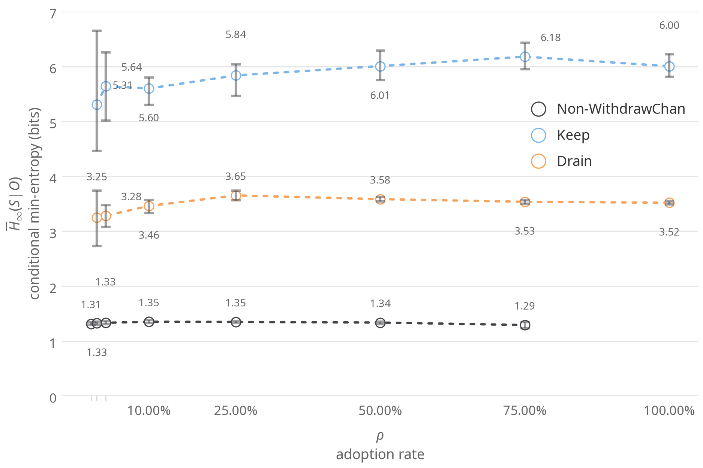
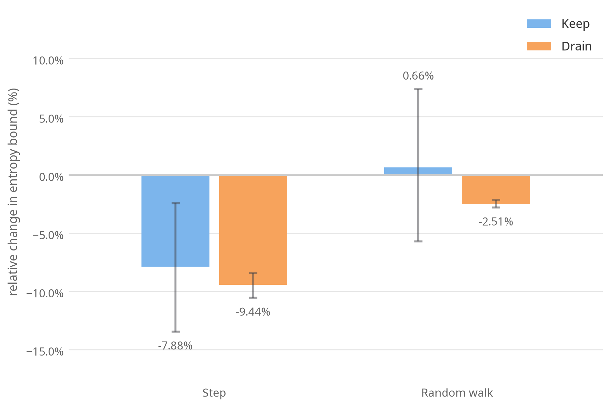
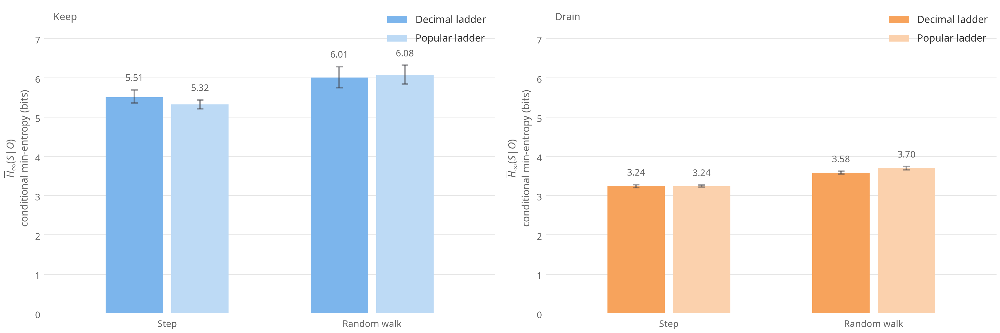

# WithdrawChan Lab README

[English](../lab/README.md) | [简体中文](lab.README.zh.md)

本目录用于复现 WithdrawChan 的隐私实验。实验以 Privacy Pools v1 的链上存入数据为起点模拟提领，再让观察者根据公开的提领金额，猜测每笔提领来自哪笔存款。项目目标请见 [仓库 README](README.zh.md)，推荐算法与符号说明请见 [`src/README.md`](src.README.zh.md)。

## 实验结果

我们比较三组提领行为。Non-WithdrawChan 按历史行为模型提领。Keep 和 Drain 使用 WithdrawChan，余额低于门槛后，Keep 将余额留在池中，Drain 则一次提光。结果以 $H$（bit）衡量，$H$ 越高，观察者越难猜中提领来自哪笔存款。定义见[材料与方法](#材料与方法)。

以下三张图均基于 USDT 的四观察者结果，使用 WithdrawChan 规则。除图 2 比较两种上限外，其余均使用默认上限。

### 图 1：按需提领并留余额，隐私性明显提升



在各组均有参与者的采用率下，Keep 的 $H$ 比 Non-WithdrawChan 高约 4–5 bits，Drain 高约 2 bits。

### 图 2：逐级随机减轻了将余额设为上限时的泄露



图中比较了 $\rho = 1/2$ 时，将上限设为余额相对于默认上限的 $H$ 变化。若每次都一定再上一级台阶（$q = 1$），输出就是不超过余额的最高一级台阶。此时，Keep 和 Drain 的 $H$ 分别下降 7.9% 和 9.4%。使用 WithdrawChan 时，Keep 没有明显变化，Drain 下降 2.5%。理论依据见[上限的影响](#上限的影响)。

### 图 3：链上常见金额没有带来一致的好处



在 $\rho = 1/2$ 时，十进制阶梯与链上常见金额阶梯的结果互有高低，未见一致优势。因此，WithdrawChan 采用十进制阶梯，不依赖链上数据。

### 三个池子

下表汇总了 $\rho = 1/2$、WithdrawChan 规则、默认上限下的结果。数值为 $H$（bit），方括号内为 95% 区间。

| 池 | Non-WithdrawChan | Drain | Keep |
| --- | --- | --- | --- |
| USDT\* | 1.34 [1.31, 1.36] | 3.58 [3.54, 3.62] | 6.01 [5.75, 6.29] |
| USDC\* | 1.57 [1.51, 1.62] | 3.82 [3.75, 3.90] | 7.65 [7.46, 7.90] |
| ETH\*\* | 2.28 [2.26, 2.31] | 4.85 [4.81, 4.89] | 9.72 [9.55, 9.89] |

\* 逐条件取四个观察者中命中率最高的结果。\*\* 逐条件取三个公开观察者中命中率最高的结果。

### 补充结果

我们另外回答了四个问题。以下比较都使用三个公开观察者，并与同一批随机数下的基线逐次重抽配对。除特别说明外，均固定 $\rho = 1/2$、默认上限。

- **随机小数 $p$ 只能帮到最后提光的人** 
    - WithdrawChan 可以按概率 $p$ 在输出上再加一个小于一个取整单位 $D$ 的随机金额（见 [`src/README.md`](src.README.zh.md)）。正文结果都是 $p = 0$。在 USDT 和 USDC 上取 $p = 1/10$ 时，Drain 的 $H$ 提高 15–19%。取 $p = 1/2$ 时提高 62–63%。Keep 和 Non-WithdrawChan 的变化都在 3% 以内。
    - 可能的原因是：$p = 0$ 时，Drain 之前的每笔提领都是 $D$ 的整数倍，最后一笔提光的金额就保留了存款在 $D$ 以下的零头，观察者可以凭这个零头把它与存款相关联。加入随机金额后，这个零头被打乱。Keep 不会提出最后这一笔，所以随机零头没有意义。

- **在模拟中，取整本身有代价** 
    - 对照规则 `need` 不作取整，直接提领 $X$。与它相比，WithdrawChan 在 `combinatorial` 和 `trained-logit` 下让 $H$ 降低 1–12%，在 `historical` 下 Drain 最多降低 37%。这个代价很可能是被高估了。
    - 模拟中的 $X$ 按 0.01 个代币（ETH 为 0.00001）的网格均匀抽取，本身就带随机的小数位，原样提领应该也很难被认出。真实用户多输入整数金额，原样提出时零头反而会成为线索，这正是取整的作用。
    - 所以图 1 的提升来自按需提领和留下余额，并不来自取整。

- **WithdrawChan 会让人多提一些** 
    - 输出 $Y$ 不小于本次至少需要提领的金额 $X$。按 $(Y-X)/X$ 计，采用者每笔多提的中位数约为 3–5%，九成的提领多提不超过 44–49%。多提会更快用完余额，所以 Keep 的人均提领次数比 `need` 少 13–15%。

- **ETH 的结论不依赖行为模型参数** 
    - Non-WithdrawChan 的行为模型从建模截止区块之前的提领中估计。其中 $\pi$ 是一次提光的概率，$w$ 是在 $[1, r]$ 上均匀取金额的概率，基线取 $w = 0$。
    - 我们在 ETH 上把 $\pi$ 换成其 95% 区间的两端，或取 $w = 1/2$，各重跑一次全部实验条件。采用者的 $H$ 最多变化 2%。Non-WithdrawChan 的 $H$ 变化 −3% 到 +16%，最高为 2.64 bits，仍远低于 Drain 的 4.85 bits。图 2 和图 3 对应的比较数字变化不超过 0.2 个百分点。

### 局限

- **`group` 尚未收敛。** 在 USDT 上，将粒子数从 1000 增至 16000 后，Keep 的 $H$ 上界进一步下降 0.29 bits。
- **ETH 未运行 `group` 全网格。** 预计全网格约需 13 天。仅在 Keep、$\rho = 1/2$ 和 $1$ 下各重抽 3 次进行核对。加入 `group` 后，上界分别收紧 0.16 和 0.66 bits，未改变这些核对条件下的结论。

## 材料与方法

### 数据来源

`manifests/*.json` 清单固定了链 ID、合约、$D$、起止区块、结束区块哈希，以及快照的 sha256。`lab fetch` 从 RPC 节点获取日志，`lab snapshot` 将日志解码为快照，并核对哈希是否一致。建模截止区块（配置中的 `split_block`）之前的数据用于估计 Non-WithdrawChan 的行为模型。模拟人群由该区块之前余额为正的全部存款组成。

| 池子 | 结束区块 | 建模截止区块 | 存款数 $N$ |
| ---- | -------: | -------: | ------: |
| USDT | 26078315 | 25603700 | 296 |
| USDC | 26078315 | 25603700 | 723 |
| ETH | 26078315 | 25603700 | 3973 |

### 模拟参数

- **三组提领行为：** Non-WithdrawChan 按历史行为模型提领。Keep 和 Drain 在余额不低于门槛（10 USDT/USDC，0.01 ETH）时使用 WithdrawChan。余额低于门槛后，Keep 将余额留在池中，Drain 则一次提光。
- **采用率：** $\rho \in \{0, 1/100, 1/40, 1/10, 1/4, 1/2, 3/4, 1\}$，采用人数为 $K = \lfloor \rho N + 1/2 \rfloor$。
- **至少需要提领的金额：** $X$ 在 $[0.01, r]$ 上按 0.01 个代币（ETH 为 0.00001）的网格均匀抽取，其中 $r$ 为当前余额。
- **规则：** WithdrawChan 在配置中记为 `decsmooth`。对照规则包括 `need`（直接提领 $X$）、`decstep`（$q = 1$），以及将十进制阶梯替换为链上常见金额阶梯的 `popstep` 和 `popsmooth`。
- **上限：** `double` 使用默认上限，`balance` 将上限设为当前余额。
- **重复抽样：** 每个配置重抽 10 次。

### 观察者和指标

| 观察者 | 知道什么 |
| --- | --- |
| `historical` | 历史行为模型 |
| `trained-logit` | 在模拟路径上训练得到的金额与余额零头特征 |
| `combinatorial` | 公开金额，以及哪些存款的余额足以支付这笔提领 |
| `group` | 提领规则，以及路径上的采用者使用 Keep 还是 Drain。以 1000 个粒子近似推断 |

指标为 $H = -\log_2 h$，单位为 bit。$h$ 是观察者一次猜测命中真实来源的比例，先汇总各次重抽中的命中情况，再取对数。$H$ 越高，表示该观察者越难猜中。每个实验条件均取命中率最高的观察者，报告的 $H$ 是条件最小熵上界的估计。区间为 2000 次 bootstrap 得到的 95% 区间。

### 上限的影响

[`src/README.md`](src.README.zh.md) 显示：在固定 $X$、$D$ 且 $p = 0$ 时，同一个输出在任意两个不小于它的合法上限下，出现概率之比介于 $1-q$ 与 $1/(1-q)$ 之间。

当 $q = 1/2$，并将上限设为余额时，对余额都不小于 $y$ 的任意两个候选，观察到 $y$ 之后，两者被关联的概率之比最多变为观察之前的 2 倍或 1/2。

## 复现方式

```bash
uv sync
uv run lab fetch manifests/ppv1-usdt-26078315.json --rpc <RPC> --data <data>
uv run lab snapshot manifests/ppv1-usdt-26078315.json --data <data>
uv run lab train-logit configs/usdt.json --data <data> --out <out>
uv run lab run configs/usdt.json --data <data> --out <out> --logit-beta <out>/logit_beta.json
uv run lab summarize <out>
uv run lab figures <out>
```

要复现四观察者结果，需先在配置的 `observers` 中加入 `group`，再用新的输出目录（`--out`）重跑，使用 trained-logit 观察者时传入 `--logit-beta <out>/logit_beta.json`。随后使用 `summarize --best-observers='["historical", "trained-logit", "combinatorial", "group"]'` 和 `figures --comparison-observer best`。补充结果的配置也位于 `configs/`，可用 `lab compare` 进行配对比较。测试与开发说明见 [`SKILL.md`](../lab/SKILL.md)。
