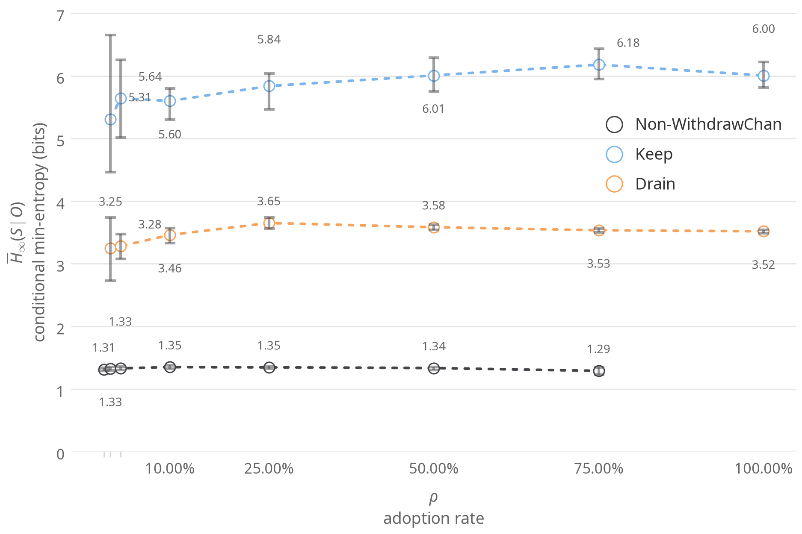
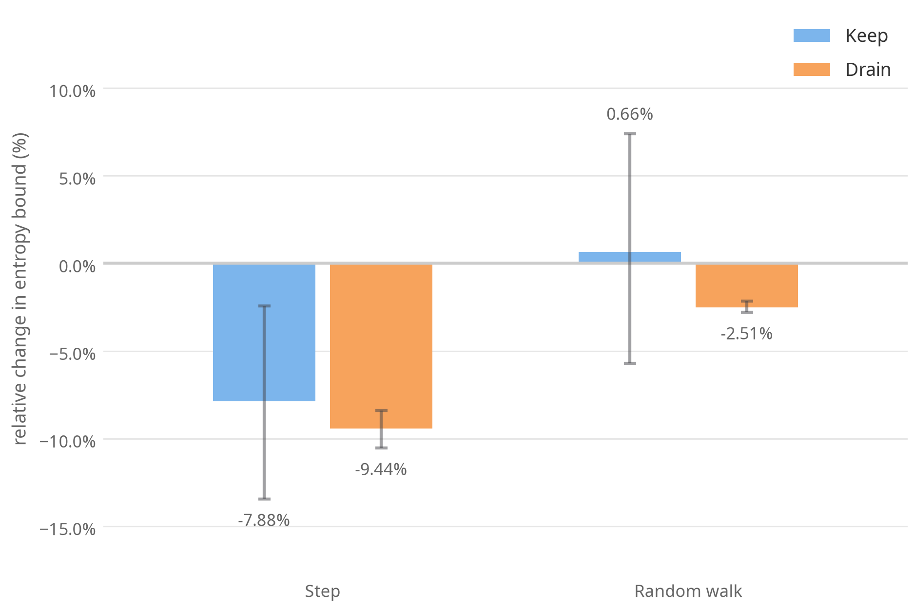
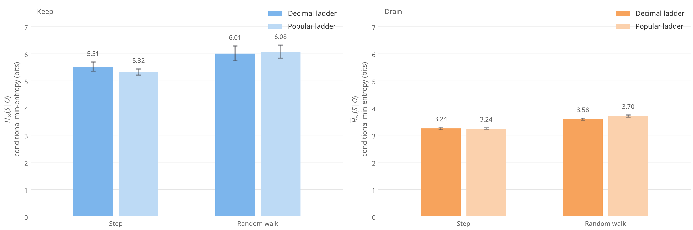

# WithdrawChan Lab README

[English](README.md) | [简体中文](../doc/lab.README.zh.md)

This directory reproduces WithdrawChan's privacy experiments. Starting from on-chain deposit data in Privacy Pools v1, the experiments simulate withdrawals. Observers then guess which deposit each withdrawal came from, using only the public withdrawal amount. For the project's aims, see the [repository README](../README.md). For the recommendation rule and notation, see [`src/README.md`](../src/README.md).

## Results

We compare three withdrawal behaviors. Non-WithdrawChan follows a historical behavior model. Keep and Drain use WithdrawChan. Once the balance falls below a threshold, Keep leaves it in the pool and Drain withdraws it all at once. We measure results with $H$ in bits. The higher $H$ is, the harder it is for an observer to guess which deposit funded a withdrawal. See [Materials and methods](#materials-and-methods) for the definition.

The three figures below use the four-observer results for USDT and the WithdrawChan rule. All use the default upper limit except Figure 2, which compares two upper limits.

### Figure 1: Withdrawing as needed and leaving a balance clearly improves privacy



At adoption rates where every group has members, Keep's $H$ is about 4–5 bits higher than Non-WithdrawChan's. Drain's is about 2 bits higher.

### Figure 2: The random walk reduces leakage when the balance is used as the upper limit



At $\rho = 1/2$, the figure shows the change in $H$ when the upper limit is set to the balance instead of the default. If every rung climbs on ($q = 1$), the output is the highest rung not above the balance. $H$ then falls by 7.9% for Keep and 9.4% for Drain. With WithdrawChan, Keep shows no clear change and Drain falls by 2.5%. For the theory, see [Effect of the upper limit](#effect-of-the-upper-limit).

### Figure 3: The popular ladder gives no consistent advantage



At $\rho = 1/2$, the decimal ladder and the popular ladder (built from common on-chain amounts) each come out ahead in some cases. Neither has a consistent advantage. WithdrawChan therefore uses the decimal ladder and does not depend on on-chain data.

### Three pools

The table summarizes results at $\rho = 1/2$ with the WithdrawChan rule and the default upper limit. Values are $H$ in bits, with 95% intervals in brackets.

| Pool | Non-WithdrawChan | Drain | Keep |
| --- | --- | --- | --- |
| USDT\* | 1.34 [1.31, 1.36] | 3.58 [3.54, 3.62] | 6.01 [5.75, 6.29] |
| USDC\* | 1.57 [1.51, 1.62] | 3.82 [3.75, 3.90] | 7.65 [7.46, 7.90] |
| ETH\*\* | 2.28 [2.26, 2.31] | 4.85 [4.81, 4.89] | 9.72 [9.55, 9.89] |

\* In each condition, the strongest of the four observers, i.e. the one with the highest hit rate. \*\* In each condition, the strongest of the three public observers.

### Additional findings

We also answered four further questions. Every comparison below uses the three public observers. Each replicate is paired with the baseline replicate that uses the same random numbers. Unless stated otherwise, $\rho = 1/2$ and the upper limit is the default.

- **A random amount below $D$ only helps those who drain**
    - With probability $p$, WithdrawChan can add a random amount below one rounding unit $D$ to its output (see [`src/README.md`](../src/README.md)). All main results use $p = 0$. On USDT and USDC, $p = 1/10$ raises Drain's $H$ by 15–19%. $p = 1/2$ raises it by 62–63%. Keep and Non-WithdrawChan change by less than 3%.
    - A likely reason is as follows. When $p = 0$, every withdrawal before Drain's last one is a multiple of $D$. The last withdrawal therefore keeps the deposit's remainder below $D$, and an observer can use that remainder to link it to the deposit. A random amount scrambles the remainder. Keep never makes that last withdrawal, so a random remainder does not help it.

- **Rounding itself has a cost in the simulation**
    - The control rule `need` withdraws $X$ unchanged, without rounding. Compared with `need`, WithdrawChan lowers $H$ by 1–12% under `combinatorial` and `trained-logit`, and by up to 37% for Drain under `historical`. This cost is probably overestimated.
    - In the simulation, $X$ is drawn uniformly on a 0.01-token grid (0.00001 ETH), so it already carries random decimal places. Withdrawn unchanged, it should still be hard to recognize. Real users usually type whole amounts. Withdrawn unchanged, their remainder becomes a clue. This is what rounding guards against.
    - So the gain in Figure 1 comes from withdrawing as needed and leaving a balance, not from rounding.

- **WithdrawChan makes people withdraw a little more**
    - The output $Y$ is never below the minimum amount to withdraw, $X$. Measured as $(Y-X)/X$, adopters withdraw a median of about 3–5% extra per withdrawal. Nine in ten withdrawals are no more than 44–49% above $X$. Withdrawing extra uses up the balance sooner, so Keep makes 13–15% fewer withdrawals per person than `need`.

- **The ETH conclusions do not depend on the behavior-model parameters**
    - We estimate Non-WithdrawChan's behavior model from withdrawals before the modeling cutoff block. Here $\pi$ is the probability of withdrawing the whole balance at once and $w$ is the probability of drawing the amount uniformly from $[1, r]$. The baseline uses $w = 0$.
    - On ETH, we reran every condition with $\pi$ set to either end of its 95% interval, or with $w = 1/2$. Adopters' $H$ changes by at most 2%. Non-WithdrawChan's $H$ changes by −3% to +16% and reaches at most 2.64 bits, still well below Drain's 4.85 bits. The comparisons behind Figures 2 and 3 change by no more than 0.2 percentage points.

### Limitations

- **`group` has not converged.** On USDT, raising the particle count from 1,000 to 16,000 lowers the upper bound on Keep's $H$ by a further 0.29 bits.
- **We did not run the full `group` grid on ETH.** It would take about 13 days. Instead, we ran three replicates each for Keep at $\rho = 1/2$ and $\rho = 1$. Adding `group` tightens the upper bounds by 0.16 and 0.66 bits respectively. It does not change the conclusions under these conditions.

## Materials and methods

### Data

The manifests in `manifests/*.json` pin the chain ID, contract, $D$, start and end blocks, end-block hash and the snapshot's SHA-256. `lab fetch` downloads logs from an RPC node. `lab snapshot` decodes them into a snapshot and checks the hash. Data before the modeling cutoff block (`split_block` in the configuration) are used to estimate Non-WithdrawChan's behavior model. The simulated population is every deposit with a positive balance before that block.

| Pool | End block | Modeling cutoff block | Deposits $N$ |
| ---- | --------: | --------------------: | -----------: |
| USDT | 26078315 | 25603700 | 296 |
| USDC | 26078315 | 25603700 | 723 |
| ETH | 26078315 | 25603700 | 3973 |

### Simulation parameters

- **Three withdrawal behaviors:** Non-WithdrawChan follows the historical behavior model. Keep and Drain use WithdrawChan while the balance is at least the threshold (10 USDT or USDC, 0.01 ETH). Once the balance falls below it, Keep leaves it in the pool and Drain withdraws it all at once.
- **Adoption rate:** $\rho \in \{0, 1/100, 1/40, 1/10, 1/4, 1/2, 3/4, 1\}$, with $K = \lfloor \rho N + 1/2 \rfloor$ adopters.
- **Minimum amount to withdraw:** $X$ is drawn uniformly from a 0.01-token grid (0.00001 ETH) on $[0.01, r]$, where $r$ is the current balance.
- **Rules:** The configuration calls WithdrawChan `decsmooth`. The control rules are `need` (withdraw $X$ unchanged), `decstep` ($q = 1$), and `popstep` and `popsmooth`, which replace the decimal ladder with the popular ladder.
- **Upper limit:** `double` uses the default upper limit. `balance` sets it to the current balance.
- **Replicates:** Each configuration is run 10 times.

### Observers and metric

| Observer | What it knows |
| --- | --- |
| `historical` | The historical behavior model |
| `trained-logit` | Amount and balance-remainder features learned from simulated paths |
| `combinatorial` | The public amounts and which deposits have enough balance to fund each withdrawal |
| `group` | The rule and whether adopters on the path follow Keep or Drain. Uses 1,000 particles |

The metric is $H = -\log_2 h$ in bits. Here $h$ is the fraction of the observer's top guesses that hit the true source. Hits are pooled across replicates before taking the logarithm. A higher $H$ means the observer finds it harder to guess correctly. In each condition we take the observer with the highest hit rate, so the reported $H$ estimates an upper bound on conditional min-entropy. The 95% intervals come from 2,000 bootstrap resamples.

### Effect of the upper limit

[`src/README.md`](../src/README.md) shows that, with $X$ and $D$ fixed and $p = 0$, the probability of the same output under any two valid upper limits no smaller than it differs by a factor between $1-q$ and $1/(1-q)$.

With $q = 1/2$ and the upper limit set to the balance, take any two candidate deposits whose balances are both at least $y$. Observing $y$ can change the ratio of the probabilities that each is the source to at most twice or half its previous value.

## Reproduction

```bash
uv sync
uv run lab fetch manifests/ppv1-usdt-26078315.json --rpc <RPC> --data <data>
uv run lab snapshot manifests/ppv1-usdt-26078315.json --data <data>
uv run lab train-logit configs/usdt.json --data <data> --out <out>
uv run lab run configs/usdt.json --data <data> --out <out> --logit-beta <out>/logit_beta.json
uv run lab summarize <out>
uv run lab figures <out>
```

To reproduce the four-observer results, first add `group` to `observers` in the configuration, then run into a new output directory (`--out`), passing `--logit-beta <out>/logit_beta.json` for the trained-logit observer. Then run `summarize --best-observers='["historical", "trained-logit", "combinatorial", "group"]'` and `figures --comparison-observer best`. The configurations for the additional findings are also in `configs/`. Use `lab compare` for paired comparisons. See [`SKILL.md`](SKILL.md) for testing and development.
